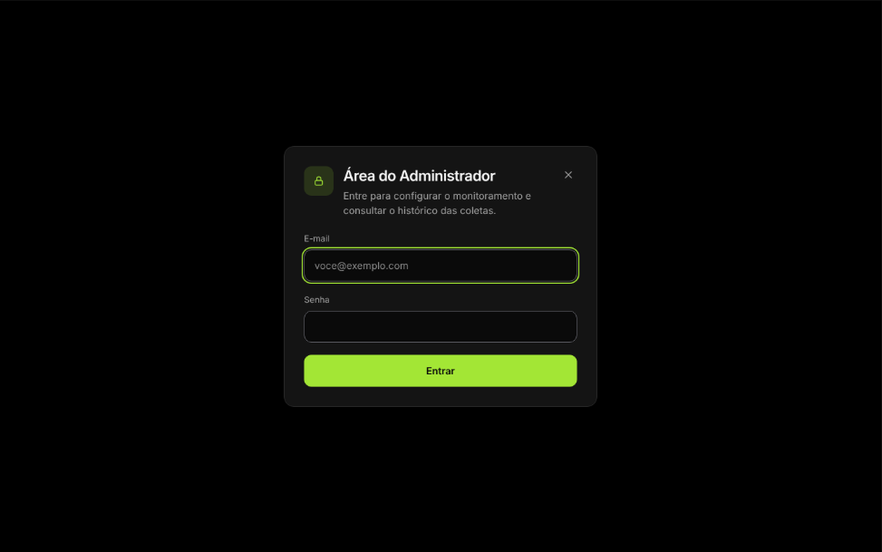
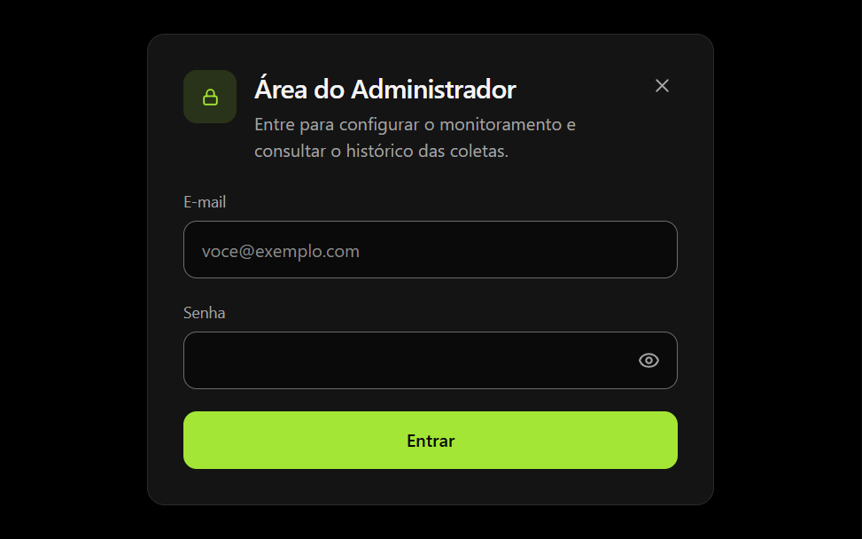

# TASK-047 — Implementação das melhorias de usabilidade

**Responsável:** Gustavo Zago  
**Base da implementação:** inspeção heurística F1–F10 do [relatório de usabilidade](relatorio-usabilidade.md), conforme alinhado para a task.  
**Situação:** implementação frontend e validação automatizada concluídas para os achados heurísticos disponíveis. Critérios de avaliação com usuários e rastreabilidade individual no GitHub permanecem pendentes.

## Escopo e limite das evidências

A avaliação com usuários representativos prevista na [TASK-046](avaliacao-usabilidade-sprint-3.md) ainda não foi realizada. Portanto, este documento não apresenta resultados, participantes ou problemas observados que não tenham sido coletados. As alterações abaixo respondem aos achados heurísticos F1–F10 disponíveis.

## Implementações

| Achado | Implementação e situação |
|---|---|
| F1 — contraste de bordas | O token `edge` oferece contraste de pelo menos 3:1 nos fundos verificados. Os testes de contraste também cobrem esse mínimo e as cores dos gráficos. |
| F2 — feedback no login | Estados de erro e carregamento já existentes foram mantidos; foi adicionado controle acessível para mostrar/ocultar a senha. |
| F3 — jargão no login | A nota técnica sobre `.env.local` apontada no protótipo não aparece na tela de login implementada. O rodapé da demonstração explica em linguagem direta que os dados são simulados no navegador. |
| F4 — exposição de JWT | O token continua sem ser exibido na interface. |
| F5 — exclusão do histórico | “Limpar histórico” agora exige confirmação em diálogo nativo; cancelar ou pressionar Escape não chama a exclusão. A opção destrutiva tem destaque próprio e o foco inicial fica em “Cancelar”. |
| F6 — contagem de resultados | A contagem do painel de filtros esclarece, inclusive para tecnologias assistivas, que compara os resultados após os filtros ao total monitorado. A consistência com dados reais precisa ser confirmada no ambiente integrado. |
| F7 — idioma dos países | Os nomes de países recebidos em inglês são apresentados em português nas telas de serviço, mapa e comparação, incluindo a variante “United States of America”. A busca também aceita o nome localizado; valores desconhecidos são preservados. |
| F8 — legibilidade | Textos de apoio selecionados no dashboard, mapa e área administrativa foram elevados de 11 para 12 px; rótulos dos gráficos também usam 12 px. |
| F9 — gráficos | As séries usam linhas com estilos distinguíveis, tooltip e camada de acessibilidade por teclado do Recharts. A comparação diferencia as séries também por padrões de traço. |
| F10 — intervalo e pausa | O texto esclarece que cada ciclo representa 15 minutos simulados; o controle da atualização automática apresenta os estados e nomes acessíveis “Pausar” e “Retomar”. |

Nenhum dado de demonstração foi adicionado à aplicação. As fixtures existentes são usadas somente nos testes.

## Rastreamento local das alterações

| Achados | Arquivos principais |
|---|---|
| F1 | [tokens](../../frontend/src/styles/index.css), [testes de contraste](../../frontend/tests/contrast.test.ts) |
| F2 | [FormField](../../frontend/src/components/FormField.tsx), LoginModal (estados preexistentes) |
| F3–F4 | [AppLayout](../../frontend/src/components/AppLayout.tsx); o JWT continua sem ser renderizado na interface |
| F5 | [Histórico administrativo](../../frontend/src/components/admin/history-table.tsx) |
| F6 | [Painel de filtros](../../frontend/src/components/dashboard/filters-panel.tsx), [dashboard](../../frontend/src/components/dashboard/dashboard-view.tsx) |
| F7 | [Formatação e localização](../../frontend/src/lib/format.ts), [busca](../../frontend/src/lib/dashboard-filters.ts), cards, tabela, comparação e popup do mapa |
| F8 | [GlassCard](../../frontend/src/components/dashboard/glass-card.tsx), cabeçalho executivo, páginas Admin e Mapa |
| F9 | [Gráfico de evolução](../../frontend/src/components/dashboard/evolution-chart.tsx), [comparação](../../frontend/src/components/dashboard/comparison-panel.tsx) |
| F10 | [Cabeçalho](../../frontend/src/components/dashboard/app-header.tsx), [AppLayout](../../frontend/src/components/AppLayout.tsx) |

Esse rastreamento no código não substitui a issue individual exigida pelo aceite; as issues ainda precisam ser criadas e associadas à TASK-047.

## Evidência visual

| Antes — captura existente | Depois — captura local |
|---|---|
|  |  |

As imagens de login estão no mesmo tamanho (778×486); a imagem “antes” foi redimensionada da captura existente de 1440×900. A captura posterior mostra a tela sem credenciais. As telas abaixo são capturas complementares feitas no modo de demonstração existente da aplicação, explicitamente identificado na própria interface; não representam dados reais nem participantes:

- [Observatório — modo de demonstração](../evidencias/task-047-observatorio-simulacao.png): inclui os gráficos com estilos de linha distintos, contagem de resultados e nomes de países localizados.
- [Mapa — modo de demonstração](../evidencias/task-047-mapa-simulacao.png): mostra o rótulo de período em linguagem simples, navegação por teclado indicada na interface e legenda dos marcadores.

As capturas de mapa e observatório foram obtidas localmente; o backend não estava disponível durante esta execução. Não há captura posterior da confirmação de exclusão do histórico, pois a área administrativa requer uma sessão autenticada no backend.

## Validação executada

Comandos executados em `greener/frontend`:

| Comando | Resultado |
|---|---|
| `npm test` | Aprovado — 23 arquivos, 176 testes. |
| `npm run lint` | Aprovado. |
| `npm run build` | Aprovado; o Vite emitiu o aviso existente de chunk JavaScript acima de 500 kB. |
| `git -c core.whitespace=cr-at-eol diff --check` | Aprovado. |

Verificação manual no navegador: o controle alternou o campo entre `password` e `text`, e retornou a `password`. As chamadas ao backend local falharam com `ERR_EMPTY_RESPONSE`; portanto, a integração com dados reais não foi validada nesta execução. Não houve teste com participantes.

## Pendências para concluir os critérios da task

- Criar ou associar uma issue individual do GitHub a cada correção de IHC e ligá-las à TASK-047.
- Registrar evidências antes/depois da confirmação de exclusão e demais estados não cobertos pelas capturas.
- Executar a avaliação com usuários representativos planejada na TASK-046 e só então documentar os resultados reais.
- Revalidar contagens e fluxos que dependem do backend em um ambiente integrado.

Assim, a implementação e os testes locais estão prontos para revisão, mas os critérios de rastreabilidade por issue e avaliação com participantes não devem ser marcados como concluídos sem os respectivos registros.
