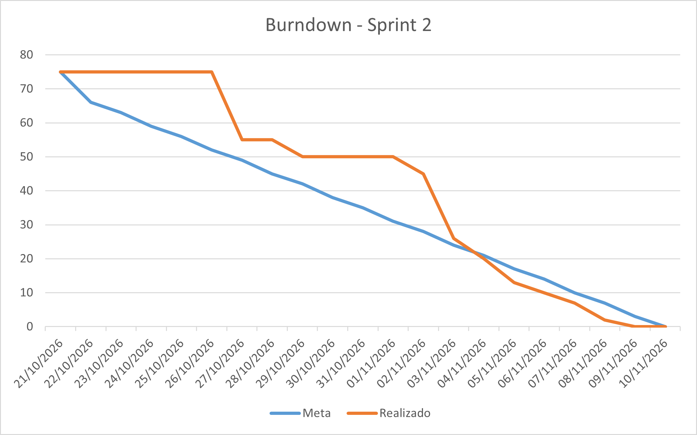

# 🌱 GreenER — Sprint 2: Estimativas Ambientais e Dashboard

Sprint dedicada a transformar as métricas coletadas em estimativas ambientais de consumo energético e emissões de CO₂e. O trabalho contempla a integração com a API de intensidade de carbono por região, o uso de fallback configurável, a persistência dos dados ambientais, a criação de indicadores públicos e a evolução do dashboard com cards, mapa, comparação e atualização dinâmica. Também foram fortalecidos os testes, a documentação Swagger e README, a compatibilidade do ambiente Docker, a segurança e o fluxo de integração.

Acompanhamento, responsáveis e status das tasks estão no [GitHub Projects](https://github.com/orgs/CyberChese/projects/2/views/3).

---

## 📊 Burndown e demonstração

---

Vídeo da Sprint Review: [Assistir à demonstração da Sprint 2](https://youtu.be/1soOS-lRddQ).

---

## 🎯 Objetivo da Sprint

Converter as métricas coletadas em estimativas de consumo de energia (kWh) e emissões (CO₂e), usando a intensidade de carbono por região, e apresentar esses dados no dashboard operacional com documentação, testes e evidências de qualidade.

---

## 📦 Entregas e escopo

- [x] Motor determinístico de cálculo de energia e emissão de CO₂e.
- [x] Integração com a API de intensidade de carbono por região, com timeout, validação e fallback configurável.
- [x] Persistência do `region_code`, energia, intensidade aplicada e emissões junto às coletas.
- [x] Endpoint público `GET /api/metrics/summary` e indicadores consolidados no frontend.
- [x] Cards de serviços, mapa geográfico, polling e estados de carregamento, erro e ausência de dados.
- [x] Correção semântica dos estados de coleta HTTP 404 e 500.
- [x] Testes unitários e de componentes sem dependência de rede real, segredo ou banco compartilhado.
- [x] Swagger, README, pipeline CI, runtime Node 24 e endurecimento de segredos.
- [x] Checklist de PR, revisão técnica e evidências de integração.

---

## 📋 Tabela de Tasks — Sprint 2

### Capacidade da equipe

| Integrante | Tasks | Pontos |
|---|---|---:|
| Lucas Cobra | TASK-020, TASK-022, TASK-036 | 13 |
| Gabriel Moura | TASK-023, TASK-029, TASK-031, TASK-032 | 10 |
| Isabelly Marinho | TASK-027, TASK-030, TASK-033 | 9 |
| Ronaldo | TASK-024, TASK-028, TASK-037 | 8 |
| Luka Gomes | TASK-025, TASK-026, TASK-034, TASK-035, TASK-040 | 22 |
| Gustavo Zago | TASK-021, TASK-038, TASK-039 | 13 |
| **Total** | **21 tasks** | **75** |

### Tabela de rastreabilidade

| Task | Responsável | Tipo | Módulo | Nome | RFs | RNFs / RPs | Prioridade | Pts |
|---|---|---|---|---|---|---|---|---:|
| TASK-020 | Lucas Cobra (`@LucasCobraFatec`) | BE | Engine | Definição e implementação do modelo de consumo energético (kWh) | RF02 | RNF02 · RP02 | 🔴 Crítica | 5 |
| TASK-021 | Gustavo Zago (`@Gustavo-Zago`) | BE | Carbon | Cliente HTTP de intensidade de carbono por região | RF07 | RNF05 · RP04 | 🔴 Crítica | 5 |
| TASK-022 | Lucas Cobra (`@LucasCobraFatec`) | BE | Engine | Cálculo e persistência de emissões de CO₂e | RF02 | RNF02 · RNF07 | 🔴 Crítica | 3 |
| TASK-023 | Gabriel Moura (`@gafmoura7`) | BE | Analytics | Resumo público de indicadores da plataforma | RF08 | RNF04 · RP02 | 🔴 Crítica | 3 |
| TASK-024 | Ronaldo (`@RonaldoAvilaa`) | FE | UI/UX | Header executivo e cards de indicadores | RF06 · RF08 | RNF01 | 🟡 Alta | 3 |
| TASK-025 | Luka Gomes (`@LukaGomes`) | FE | UI/UX | Grid e cards de serviços com estados visuais | RF04 · RF06 | RNF01 · RP09 | 🔴 Crítica | 5 |
| TASK-026 | Luka Gomes (`@LukaGomes`) | FE | Mapa | Mapa geográfico interativo | RF09 | RNF01 · RP01 | 🟡 Alta | 5 |
| TASK-027 | Isabelly Marinho (`@isabellymarinho20`) | FE | Realtime | Polling e sincronização sem recarregar a página | RF06 | RNF03 · RP01 | 🟡 Alta | 3 |
| TASK-028 | Ronaldo (`@RonaldoAvilaa`) | DB | Metrics | Índices e persistência para consultas do dashboard | RF05 | RNF04 · RP03 | 🟡 Alta | 3 |
| TASK-029 | Gabriel Moura (`@gafmoura7`) | BE | Testes | Testes unitários do motor ambiental e carbono | RF02 · RF07 | RNF07 | 🟡 Alta | 3 |
| TASK-030 | Isabelly Marinho (`@isabellymarinho20`) | FE | Testes | Testes de componentes e fluxos do dashboard | RF06 · RF09 | RNF01 · RNF07 | 🟡 Alta | 3 |
| TASK-031 | Gabriel Moura (`@gafmoura7`) | DOCS | Docs | Swagger, contratos e README da Sprint 2 | — | RNF08 · RP06 | ⚪ Baixa | 2 |
| TASK-032 | Gabriel Moura (`@gafmoura7`) | DOCS | Gestão | Burndown e evidências da Sprint 2 | — | RP06 · RNF08 | ⚪ Baixa | 2 |
| TASK-033 | Isabelly Marinho (`@isabellymarinho20`) | BE | Discovery/DB | Persistência do código de região do Agregador | RF07 · RF09 | RNF04 | 🔴 Crítica | 3 |
| TASK-034 | Luka Gomes (`@LukaGomes`) | BE | Metrics | Correção semântica dos estados de coleta HTTP 404/500 | RF05 · RF06 | RNF05 · RNF07 | 🔴 Crítica | 2 |
| TASK-035 | Luka Gomes (`@LukaGomes`) | FE | UI/UX/IHC | Responsividade, contraste e validação do Design System | — | RNF01 · RP09 | 🔴 Crítica | 5 |
| TASK-036 | Lucas Cobra (`@LucasCobraFatec`) | INFRA | CI | Pipeline CI para verificações obrigatórias | — | RNF07 · RNF08 · RP06 | 🟡 Alta | 5 |
| TASK-037 | Ronaldo (`@RonaldoAvilaa`) | INFRA | Runtime | Compatibilidade Node, engines e testes na imagem oficial | — | RNF07 · RNF08 | 🟡 Alta | 2 |
| TASK-038 | Gustavo Zago (`@Gustavo-Zago`) | BE | Segurança | Endurecimento de segredos e proteção contra tentativas de login | RF16 | RNF06 · RNF07 | 🟡 Alta | 5 |
| TASK-039 | Gustavo Zago (`@Gustavo-Zago`) | DOCS | Processo | Revisão técnica de PRs e proteção do fluxo de integração | — | RNF07 · RNF08 · RP06 | 🟡 Alta | 3 |
| TASK-040 | Luka Gomes (`@LukaGomes`) | FE | UI/UX | Exibir energia e CO₂e por serviço no frontend | RF02 · RF04 · RF06 | RNF01 | 🔴 Crítica | 5 |

---

## 📌 Dependências e pendências herdadas da Sprint 1

| Pendência | Critério | Situação na Sprint 2 |
|---|---|---|
| Executar a descoberta de serviços periodicamente | DW02 | Ainda pendente: a descoberta ocorre na inicialização do backend |
| Persistir o `region_code` dos serviços | DW02 | Tratada pela TASK-033 |
| Atualizar a imagem do backend para Node 24 e rodar os testes no container | DW07, TP04 | Tratada pela TASK-037 |
| Criar a camada de repositories e separar responsabilidades do `MetricsService` | DW03, TP01 | Permanece como refatoração pendente |
| Remover código sem uso | TP03 | Permanece como limpeza técnica pendente |
| Configurar Swagger em `/api/docs` | DW07 | Tratada pela TASK-031 |

---

## 🔁 Ações de melhoria vindas da retrospectiva da Sprint 1

Ver [Retrospectiva da Sprint 1](sprint-1.md#-retrospectiva).

| Ação | Como será aplicada | Situação |
|---|---|---|
| Atualizar a documentação junto com cada PR | Incluir documentação no checklist da Definition of Done | Em aplicação |
| Revisar critérios de aceite quando a implementação mudar | Registrar a alteração e a justificativa na própria história | Em aplicação |
| Rodar os testes no mesmo ambiente documentado no README | Usar a imagem Node 24 e os comandos documentados no Docker | Concluída na validação atual |
| Separar no README o que está implementado do que está planejado | Manter as seções de funcionalidades e próximos passos atualizadas | Concluída |

---

## 🔗 Notas de execução

- A TASK-040 foi dividida em dois PRs: camada de dados e camada visual.
- As branches da TASK-040 devem usar o identificador correto da task:
  - `feat/TASK-040-exibir-energia-co2e-dados`
  - `feat/TASK-040-exibir-energia-co2e-telas`
- A descrição detalhada e os critérios de aceite de cada task devem permanecer alinhados ao card correspondente no GitHub Projects.

---

## 🔒 Processo de PR e registro da entrega

Aplicar o processo de contribuição e o template de Pull Request em todas as entregas: escopo pequeno, critérios de aceite e CI evidenciados, análise técnica substantiva por integrante diferente do autor e integração por PR.

As evidências de proteção de branches, reviews, tag e release devem ser registradas somente quando verificadas no GitHub. Não afirmar regras de proteção ou artefatos que ainda não estejam acessíveis ou publicados.

---

## ✅ Definition of Done da Sprint 2

1. Task possui critérios de aceite revisados e evidências vinculadas.
2. Código, testes e documentação foram atualizados no mesmo fluxo de entrega.
3. Build, lint e testes foram executados no ambiente documentado.
4. PR possui review técnico substantivo de outro integrante.
5. Burndown, Sprint Review, retrospectiva e artefato de fechamento foram registrados.

---

## 🎬 Sprint Review e fechamento

### Entregas demonstradas

- Motor de cálculo de energia e emissões de CO₂e.
- Integração com intensidade de carbono, fallback e persistência dos dados ambientais.
- Dashboard com indicadores, cards de serviços, mapa, comparação e estados operacionais.
- Endpoint público de resumo, documentação Swagger e execução via Docker.

### Verificação realizada no fechamento

| Verificação | Resultado |
|---|---|
| Burndown da Sprint 2 | 75 pontos realizados; linha de realizado chegou a zero em 09/11/2026 |
| Vídeo da Sprint Review | [Demonstração da Sprint 2](https://youtu.be/1soOS-lRddQ) |
| Testes do backend | 83 testes aprovados |
| Testes do frontend | 102 testes aprovados |
| Build do backend e frontend | Aprovado |
| Lint do backend e frontend | Aprovado, com avisos preexistentes no backend |
| Configuração do Docker Compose | `docker compose config` aprovado |

---

## 🔄 Retrospectiva

Pontos levantados no fechamento da sprint, a partir das entregas realizadas, dos testes e das pendências identificadas.

### O que funcionou bem

- A distribuição das tasks por responsável facilitou o acompanhamento da execução.
- A integração entre backend, frontend e banco permitiu entregar o fluxo completo de indicadores ambientais.
- O uso de PRs manteve as alterações organizadas e vinculadas às respectivas tasks.
- A cobertura de testes foi ampliada para os motores de energia e carbono, frontend, autenticação e integração com APIs.
- O ambiente Docker foi alinhado ao Node 24, permitindo executar build e testes no mesmo ambiente documentado.
- A documentação técnica foi revisada junto com a entrega, incluindo README, Swagger, endpoints, migrações e instruções de execução.
- O burndown mostrou a conclusão dos 75 pontos planejados, com o realizado chegando a zero em 09/11/2026.

### O que poderia melhorar

- O escopo da sprint aumentou durante o planejamento, exigindo maior controle de capacidade e dependências.
- Algumas tarefas tiveram dependências entre frontend, backend e documentação, o que exigiu mais coordenação entre os responsáveis.
- A documentação e as evidências finais ficaram concentradas no fechamento da sprint.
- Permaneceram pendências técnicas, como a descoberta periódica de serviços, a camada completa de repositories e a remoção de arquivos legados sem uso.
- A nomenclatura de branches e PRs precisa ser conferida com mais atenção antes do início do desenvolvimento.

---

### Ações de melhoria para a Sprint 3

| Ação | Responsável | Como verificar |
|---|---|---|
| Validar capacidade, dependências e responsáveis antes de iniciar novas tasks | Toda a equipe | Planejamento da Sprint 3 |
| Atualizar documentação, critérios de aceite e evidências junto com cada PR | Toda a equipe | PRs com documentação correspondente |
| Priorizar as pendências técnicas antes de ampliar o escopo funcional | Equipe de desenvolvimento | Issues e tasks técnicas concluídas |
| Manter o burndown e as evidências atualizados durante a sprint | Gabriel Moura (SM) | Burndown, review e retrospectiva registrados |

---

**GreenER — Plataforma para Estimativa do Impacto Ambiental de Aplicações de Software**
