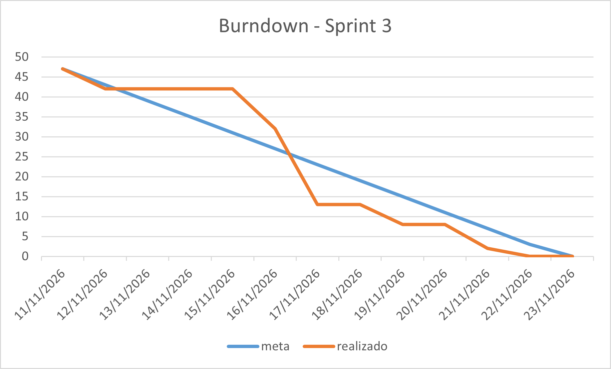

# 🌱 GreenER — Sprint 3: Comparações, Usabilidade e Entrega Final

> **Situação:** ✅ Concluída — os 47 pontos do Sprint Backlog foram concluídos no burndown e a demonstração final foi publicada.

Sprint dedicada à evolução analítica e à preparação da entrega final do GreenER. O trabalho contempla ranking e comparação entre serviços, filtros temporais, melhorias de usabilidade, descoberta periódica, refatoração da camada de dados, ampliação dos testes e revisão geral da documentação técnica.

Acompanhamento, responsáveis e status das tasks estão no [GitHub Projects](https://github.com/orgs/CyberChese/projects/2/views/3).

---

## 📊 Burndown e demonstração

---

Vídeo da Sprint Review 3: [Assistir à demonstração final](https://youtu.be/2h2wEK6j1RE).

---

## 🎯 Objetivo da Sprint

Concluir os recursos de ranking e comparação entre serviços, aplicar melhorias de usabilidade, fortalecer a qualidade técnica e organizar o repositório para a entrega final do projeto.

---

## 📦 Entregas e escopo

- [x] Endpoints públicos de ranking e comparação com filtros temporais, paginação, alinhamento de séries e resumo de eficiência.
- [x] Interface de ranking, comparação, filtros temporais e busca por serviço.
- [x] Automação da descoberta periódica de serviços e logs estruturados.
- [x] Refatoração da camada de repositories e remoção de código legado sem uso.
- [x] Suítes de testes unitários, integração, E2E e frontend, com relatório de cobertura.
- [x] Revisão do README, Swagger, Docker Compose e documentação técnica.
- [x] Guia de portfólio e relatório final de encerramento.
- [x] Avaliação de usabilidade com usuários representativos e registro das melhorias correspondentes.

---

## 📋 Tabela de Tasks — Sprint 3

| Task | Responsável | Tipo | Módulo | Nome | HU | Requisitos | Prioridade | Pts | Situação |
|---|---|---|---|---|---|---|---|---:|---|
| TASK-041 | Lucas Cobra (`@LucasCobraFatec`) | BE | Analytics | Endpoints de ranking e filtragem de impacto ambiental | HU-15 · HU-17 | RF10 · RF12 · RNF04 | 🔴 Crítica | 5 | ✅ Concluída |
| TASK-042 | Isabelly Marinho (`@isabellymarinho20`) | BE | Analytics | Endpoint e serviço de comparação multisserviços | HU-16 · HU-17 | RF11 · RF12 · RNF04 | 🔴 Crítica | 5 | ✅ Concluída |
| TASK-043 | Luka Gomes (`@LukaGomes`) | FE | UI/UX | Componente e tela de ranking de impacto ambiental | HU-15 | RF10 · RNF01 · RP01 | 🔴 Crítica | 5 | ✅ Concluída |
| TASK-044 | Gustavo Zago (`@Gustavo-Zago`) | FE | UI/UX | Comparação lado a lado e gráficos comparativos | HU-16 | RF11 · RNF01 · RP01 | 🔴 Crítica | 5 | ✅ Concluída |
| TASK-045 | Ronaldo (`@RonaldoAvilaa`) | FE | UI/UX | Filtros temporais e busca avançada com debounce | HU-17 | RF12 · RNF01 | 🟡 Alta | 3 | ✅ Concluída |
| TASK-046 | Luka Gomes (`@LukaGomes`) | DOCS/IHC | Usabilidade | Roteiro e execução da avaliação de usabilidade | HU-18 | IHC05 · RNF01 · RP06 | 🔴 Crítica | 5 | ✅ Concluída |
| TASK-047 | Gustavo Zago (`@Gustavo-Zago`) | FE | UI/UX/IHC | Aplicação das melhorias de IHC e ajustes de usabilidade | HU-19 | IHC06 · RNF01 · RP09 | 🔴 Crítica | 5 | ✅ Concluída |
| TASK-048 | Lucas Cobra (`@LucasCobraFatec`) | BE | Coletor | Descoberta periódica de serviços | HU-20 | RF01 · RNF03 · DW02 | 🟡 Alta | 3 | ✅ Concluída |
| TASK-049 | Ronaldo (`@RonaldoAvilaa`) | BE | Refatoração | Repositories e limpeza de código | HU-20 | DW03 · TP03 · RNF07 | 🟡 Alta | 3 | ✅ Concluída |
| TASK-050 | Isabelly Marinho (`@isabellymarinho20`) | TESTES | Testes | Suíte unitária, E2E e integração da Sprint 3 | HU-20 | RNF07 · RP06 | 🟡 Alta | 3 | ✅ Concluída |
| TASK-051 | Gabriel Moura (`@gafmoura7`) | DOCS | Docs | Revisão geral da documentação, Swagger e guia de portfólio | HU-20 | RNF08 · RP06 | 🟡 Alta | 3 | ✅ Concluída |
| TASK-052 | Gabriel Moura (`@gafmoura7`) | DOCS | Gestão | Gestão, burndown e relatório final de encerramento | HU-20 | RP06 · RNF08 | ⚪ Baixa | 2 | ✅ Concluída |

---

## 📌 Dependências e pendências herdadas da Sprint 2

| Item herdado | Tratamento na Sprint 3 | Situação |
|---|---|---|
| Descoberta periódica de serviços | TASK-048 implementou o agendamento e os logs do ciclo de descoberta | Concluída |
| Camada de repositories e separação de responsabilidades | TASK-049 isolou o acesso aos dados e removeu código legado sem uso | Concluída |
| Ranking, comparação e filtros do dashboard | TASK-041 a TASK-045 implementaram as camadas de backend e frontend | Concluída |
| Avaliação de usabilidade e melhorias de IHC | TASK-046 e TASK-047 foram executadas e registradas nas evidências da sprint | Concluída |
| Documentação, Swagger e preparação para a entrega final | TASK-051 e TASK-052 organizaram os artefatos de fechamento e a demonstração final | Concluída |

---

## 🔁 Ações de melhoria vindas da retrospectiva da Sprint 2

| Ação | Como foi aplicada | Situação |
|---|---|---|
| Validar capacidade, dependências e responsáveis antes de iniciar novas tasks | Responsáveis e pontos foram registrados na tabela da Sprint 3 | Concluída |
| Atualizar documentação, critérios de aceite e evidências junto com cada PR | README, Swagger, relatórios e documentos de sprint foram revisados | Concluída |
| Priorizar pendências técnicas antes de ampliar o escopo funcional | Descoberta periódica e repositories foram incluídos no escopo | Concluída |
| Manter o burndown e as evidências atualizados durante a sprint | Burndown da Sprint 3 foi anexado ao repositório | Concluída |

---

## 🔗 Notas de execução

- O burndown registra 47 pontos planejados e 47 pontos realizados, com a linha realizada chegando a zero em 23/11/2026.
- As rotas de ranking e comparação, seus parâmetros de busca e os schemas correspondentes foram documentados no [guia da API](../api.md) e no Swagger em `/api/docs`.
- A avaliação com usuários representativos foi realizada e as melhorias de IHC foram registradas sem expor dados pessoais dos participantes.
- O relatório de testes e cobertura registra 338 cenários aprovados: 139 no backend unitário/integração, 7 no E2E e 192 no frontend. Consulte o [relatório de cobertura da Sprint 3](../evidencias/relatorio-cobertura-sprint-3.md).
- O [relatório final de encerramento](../relatorio-final.md) reúne a matriz de atendimento aos requisitos e as conclusões do projeto.
- O [guia de portfólio](../guia-portfolio.md) organiza os artefatos relevantes para a apresentação final.

---

## 🔒 Processo de PR e registro da entrega

As entregas foram organizadas em branches próprias por task e integradas à `dev` por Pull Requests. O processo considera escopo coeso, critérios de aceite, testes ou evidências correspondentes e revisão técnica por integrante diferente do autor.

As evidências de proteção de branches, reviews, tags e release devem ser registradas somente quando verificadas no GitHub. Este documento registra apenas os artefatos disponíveis no repositório e o burndown fornecido para a sprint.

---

## ✅ Definition of Done da Sprint 3

1. [x] Task possui critérios de aceite revisados e evidências vinculadas.
2. [x] Código, testes e documentação foram atualizados no mesmo fluxo de entrega.
3. [x] Build, lint e testes foram executados no ambiente documentado.
4. [x] PR possui revisão técnica de outro integrante.
5. [x] Burndown e relatório de cobertura foram registrados.
6. [x] Avaliação com usuários representativos foi executada.
7. [x] Vídeo da Sprint Review 3 foi publicado e vinculado ao documento.

---

## 🎬 Sprint Review e fechamento

### Entregas demonstradas

- Ranking de impacto ambiental por energia e CO₂e.
- Comparação de 2 a 4 serviços com séries temporais alinhadas e resumo de eficiência.
- Filtros de período, busca por serviço, mapa, histórico e estados operacionais.
- Descoberta periódica, refatoração de repositories e suíte ampliada de testes.
- Swagger, README, Docker Compose, guia de portfólio e relatório final.

### Verificação realizada no fechamento

| Verificação | Resultado |
|---|---|
| Burndown da Sprint 3 | 47 pontos realizados; linha realizada chegou a zero em 23/11/2026 |
| Testes unitários e de integração do backend | 139 de 139 aprovados |
| Testes E2E com PostgreSQL | 7 de 7 aprovados |
| Testes do frontend | 192 de 192 aprovados |
| Total consolidado de cenários | 338 de 338 aprovados |
| Swagger e documentação técnica | Rotas, parâmetros e schemas da Sprint 3 documentados |
| Vídeo da Sprint Review 3 | [Demonstração final](https://youtu.be/2h2wEK6j1RE) |

### Evidências do fechamento

- [Burndown da Sprint 3](../evidencias/burndown-sprint-3.png)
- [Relatório de testes e cobertura](../evidencias/relatorio-cobertura-sprint-3.md)
- [Avaliação de usabilidade](../ihc/avaliacao-usabilidade-sprint-3.md)
- [API e Swagger](../api.md)
- [Guia de portfólio](../guia-portfolio.md)
- [Relatório final](../relatorio-final.md)
- [README principal](../../../README.md)

---

## 🔄 Retrospectiva

Pontos levantados no fechamento da sprint, a partir das entregas realizadas, dos testes e das evidências reunidas.

### O que funcionou bem

- A distribuição das tasks por responsável facilitou o acompanhamento e a prestação de contas.
- As dependências entre backend, frontend, testes e documentação foram registradas no Sprint Backlog.
- O uso de Pull Requests manteve as mudanças revisáveis e vinculadas às tasks.
- O burndown acompanhou a redução dos 47 pontos até zero.
- A integração entre Docker, PostgreSQL, NestJS e React permitiu validar o fluxo completo do produto.

### O que poderia melhorar

- As evidências de vídeo, cobertura e usabilidade deveriam ser coletadas durante a sprint, e não somente no encerramento.
- O acompanhamento de critérios dependentes de evidência externa precisa ser separado do status de implementação técnica.
- A conferência de links e nomes de arquivos deve ocorrer antes da abertura da Pull Request final.

---

**GreenER — Plataforma para Estimativa do Impacto Ambiental de Aplicações de Software**
